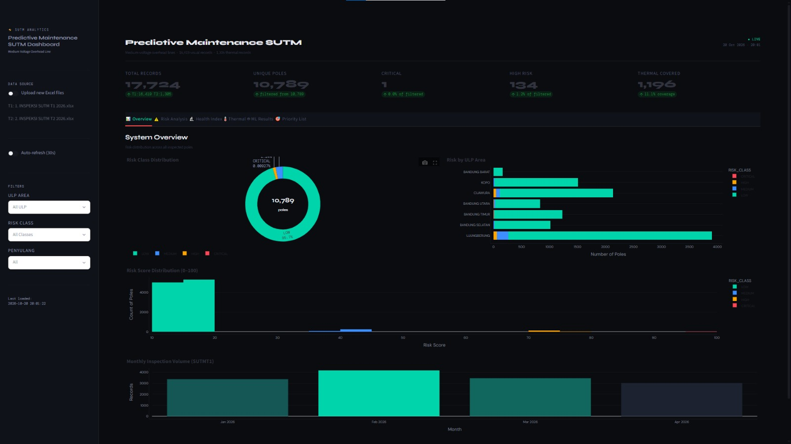

# SUTM Predictive Maintenance Dashboard

**Academic project · Telkom University · Data courtesy of PT PLN UP3 Bandung**

An interactive Streamlit dashboard that analyzes visual and thermal
inspection data of medium-voltage overhead distribution lines (SUTM),
scores asset health and risk, and ranks poles for maintenance
priority using machine learning.

## Problem and approach

Inspection data for overhead lines is collected in spreadsheets, which
makes it hard to see which feeders and components need attention first.
This project turns 16,419 visual and 1,305 thermal inspection records
(10,789 unique poles) into an interactive dashboard that supports
condition-based maintenance decisions.

**Pipeline:** component condition text → health index (0–3) →
rule-based risk class (Critical / High / Medium / Low) → risk score →
ML model comparison → maintenance priority list.

## Key features

| Tab | Contents |
|-----|----------|
| Overview | KPI cards, risk distribution, risk by ULP, monthly inspection volume |
| Risk Analysis | Risk treemap, top feeders, per-ULP summary |
| Health Index | 12-component health index, heatmap, worst-condition ranking |
| Thermal | ΔT distribution and thermal health index |
| ML Results | Model comparison (F1-score), cross-validation stability |
| Priority List | Sortable maintenance priority table with CSV export |

- Filters by ULP area, risk class and feeder
- Auto-refresh every 30 seconds, or upload new Excel files from the sidebar
- Dark-theme interface

## Tech stack

Python · Streamlit · Pandas · NumPy · Plotly

## Results

Five classifiers were compared using 5-fold stratified cross-validation
on 10,789 unique poles with 12 visual health-index features.
Risk classes were derived from a rule-based classification of
component conditions.

| Model | Accuracy | F1-Score |
|-------|----------|----------|
| **XGBoost** | **0.9342** | **0.9329** |
| Random Forest | 0.8544 | 0.8578 |
| Decision Tree | 0.8274 | 0.8396 |
| SVM | 0.7886 | 0.7937 |
| KNN | 0.7767 | 0.7685 |

XGBoost achieved the best performance, with a fold-to-fold standard
deviation of ±0.0136.

> **Note:** The dataset is highly imbalanced (about 95.7% Low risk and
> a single Critical pole), so weighted F1 is reported alongside accuracy.
> Because labels come from a rule-based classification, the scores
> reflect how well each model learns that rule from the health-index features.

> **Honest limitation:** these model figures were produced offline, before this
> repository existed, and are shown in the dashboard as static values. They are
> **not** reproduced by the code here. A training notebook that regenerates them
> from the inspection data is the next planned addition; until it lands, treat
> the table as a record of an earlier experiment rather than as a verifiable result.

## Tests

The scoring logic lives in `sutm_core.py`, apart from the dashboard, so it can be
tested without the confidential workbooks: every test builds its own small frame
in the shape of the real sheets.

    pip install -r requirements.txt pytest
    pytest -q      # 37 tests

They cover the condition-text to health-index mapping (including notes that
contain several findings), the risk rule and its score bands, worst-case
aggregation per pole, the thermal phase spread, and the rule that poles without
a thermal survey are marked rather than assumed healthy.

## Getting started

    git clone https://github.com/Muat01/sutm-predictive-maintenance-dashboard.git
    cd sutm-predictive-maintenance-dashboard
    pip install -r requirements.txt
    streamlit run app.py

The app opens at `http://localhost:8501`.

## Data availability

The inspection data was provided by PT PLN UP3 Bandung for an academic
case study and is **not included** in this repository. To request access,
please contact me via [LinkedIn](https://www.linkedin.com/in/muatasem-hadi).

To run the dashboard, place the two inspection Excel files next to
`app.py` (file names must contain `SUTM` and `T1` / `T2`), or upload
them from the dashboard sidebar.

## Project structure

    ├── app.py                   # Streamlit dashboard (UI only)
    ├── sutm_core.py              # Scoring logic: health index, risk class, thermal
    ├── theme.py                  # MH Emerald & Gold design tokens, shared across my dashboards
    ├── tests/test_core.py        # 37 unit tests
    ├── requirements.txt          # Dependencies
    ├── .streamlit/config.toml    # Dark theme configuration
    ├── .github/workflows/        # CI: pytest on every push
    └── docs/                     # Screenshots

## Author

**Muatasem Hadi** · MEng Candidate in Industrial Engineering,
Telkom University · [LinkedIn](https://www.linkedin.com/in/muatasem-hadi)
